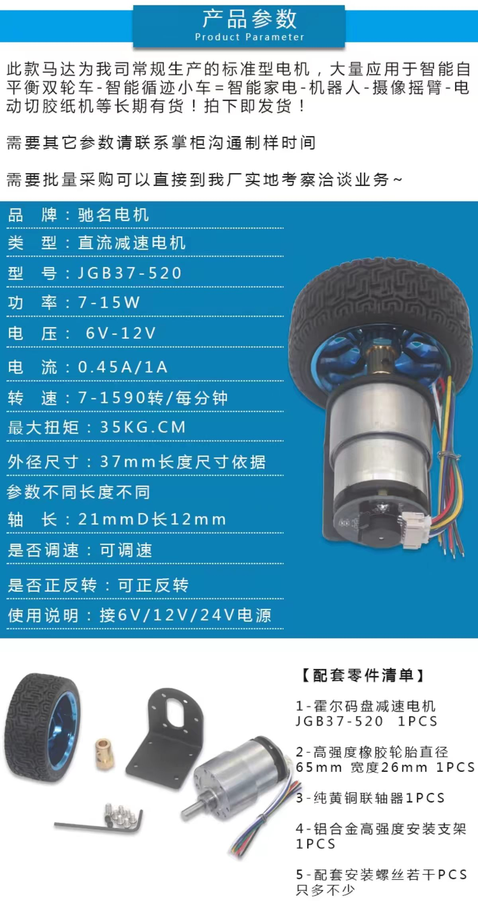
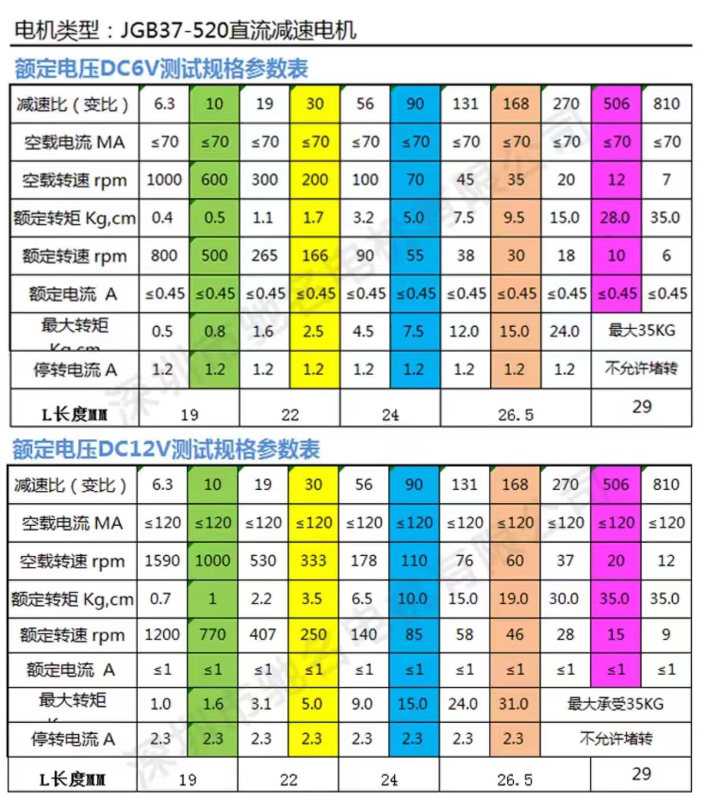
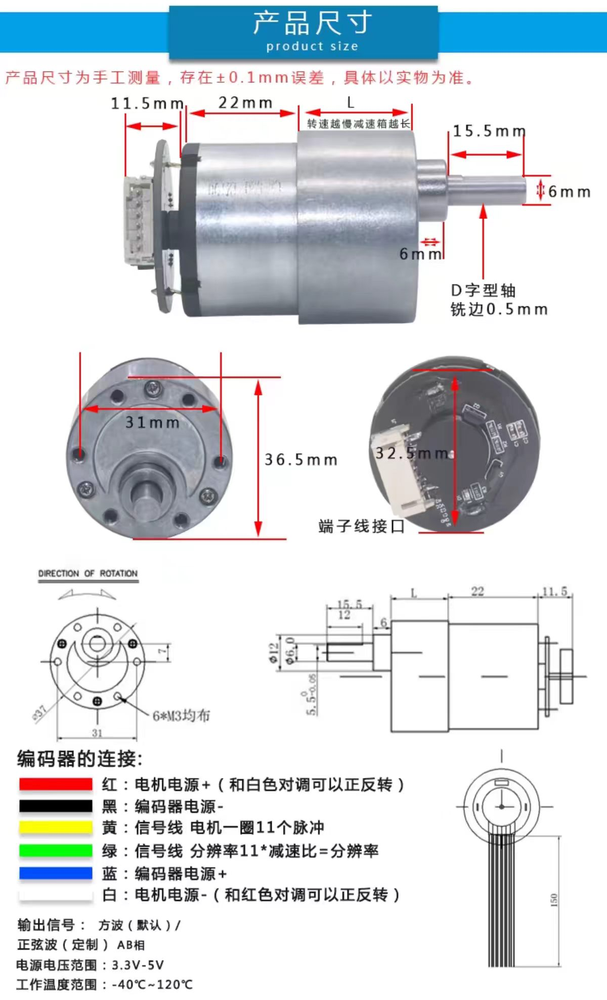

# JGB37-520 直流减速电机参数汇总

## 结论先行

`JGB37-520` 是一个减速电机系列，不是单一规格。实际选型必须同时确认**供电电压、减速比、长度 L、额定电流与编码器输出电平**。

本项目最关键的结论：

- 商品总览给出的额定电流为 `0.45 A`（6 V）或 `1 A`（12 V），参数表给出的堵转电流为 `1.2 A`（6 V）或 `2.3 A`（12 V）。
- TB6612FNG 模块通常只有约 `1 A/通道` 的连续能力；6 V 低负载原型尚可用，12 V 规格没有可靠的持续与启动余量，应优先更换更高电流驱动器。
- 编码器为 AB 相，电机轴每转 `11` 个脉冲。输出轴每转脉冲数约为 `11 × 减速比`；四倍频计数约为 `44 × 减速比`。
- 商品说明中出现“6 V/12 V/24 V”供电字样，但参数表和 TB6612 电压能力只支持按具体型号使用；**24 V 不得直接接 TB6612**。

## 基本参数

| 参数 | 规格 / 说明 |
| --- | --- |
| 品牌 | 驰名电机（商品图标注） |
| 类型 | 直流减速电机 |
| 型号 | JGB37-520 |
| 功率 | 7–15 W |
| 电压范围 | 6–12 V（按具体商品型号选择） |
| 总体空载转速范围 | 7–1590 rpm |
| 最大转矩 | 35 kg·cm |
| 电机外径 | 37 mm |
| 是否调速 | 可调速 |
| 是否正反转 | 可正反转 |
| 配套轮径 | 65 mm |
| 配套轮宽 | 26 mm |
| 编码器 | AB 相霍尔编码器，默认方波输出 |
| 编码器供电 | 3.3–5 V |
| 编码器分辨率 | 电机轴 11 脉冲/转，输出轴约为 `11 × 减速比` 脉冲/转 |
| 工作温度 | -40–120 °C |

## 机械尺寸

| 项目 | 尺寸 |
| --- | ---: |
| 电机外径 | 37 mm |
| 轮径 / 轮宽 | 65 mm / 26 mm |
| 输出轴直径 | 6 mm |
| D 形轴平切长度 | 12 mm |
| 轴总长 | 21 mm |
| 轴平切深度 | 0.5 mm |
| 安装孔 | 6 × M3 均布 |
| 安装孔中心距（图示横向） | 31 mm |
| 法兰总高（图示） | 36.5 mm |
| 编码器尾部长度 | 11.5 mm |
| 图示线束长度 | 约 150 mm |

不同减速比对应不同电机总长 `L`：

| 减速比 | L |
| --- | ---: |
| 6.3、10 | 19 mm |
| 19、30 | 22 mm |
| 56、90 | 24 mm |
| 131、168、270 | 26.5 mm |
| 506、810 | 29 mm |

## 6 V 性能表

| 减速比 | 空载转速 rpm | 额定转速 rpm | 额定转矩 kg·cm | 空载电流 | 额定电流 | 最大转矩 kg·cm | 堵转电流 |
| ---: | ---: | ---: | ---: | ---: | ---: | ---: | ---: |
| 6.3 | 1000 | 800 | 0.4 | ≤70 mA | ≤0.45 A | 0.5 | 1.2 A |
| 10 | 600 | 500 | 0.5 | ≤70 mA | ≤0.45 A | 0.8 | 1.2 A |
| 19 | 300 | 265 | 1.1 | ≤70 mA | ≤0.45 A | 1.6 | 1.2 A |
| 30 | 200 | 166 | 1.7 | ≤70 mA | ≤0.45 A | 2.5 | 1.2 A |
| 56 | 100 | 90 | 3.2 | ≤70 mA | ≤0.45 A | 4.5 | 1.2 A |
| 90 | 70 | 55 | 5.0 | ≤70 mA | ≤0.45 A | 7.5 | 1.2 A |
| 131 | 45 | 38 | 7.5 | ≤70 mA | ≤0.45 A | 12.0 | 1.2 A |
| 168 | 35 | 30 | 9.5 | ≤70 mA | ≤0.45 A | 15.0 | 1.2 A |
| 270 | 20 | 18 | 15.0 | ≤70 mA | ≤0.45 A | 24.0 | 1.2 A |
| 506 | 12 | 10 | 28.0 | ≤70 mA | ≤0.45 A | 最大 35 kg·cm | 不允许堵转 |
| 810 | 7 | 6 | 35.0 | ≤70 mA | ≤0.45 A | 最大 35 kg·cm | 不允许堵转 |

## 12 V 性能表

| 减速比 | 空载转速 rpm | 额定转速 rpm | 额定转矩 kg·cm | 空载电流 | 额定电流 | 最大转矩 kg·cm | 堵转电流 |
| ---: | ---: | ---: | ---: | ---: | ---: | ---: | ---: |
| 6.3 | 1590 | 1200 | 0.7 | ≤120 mA | ≤1 A | 1.0 | 2.3 A |
| 10 | 1000 | 770 | 1.0 | ≤120 mA | ≤1 A | 1.6 | 2.3 A |
| 19 | 530 | 407 | 2.2 | ≤120 mA | ≤1 A | 3.1 | 2.3 A |
| 30 | 333 | 250 | 3.5 | ≤120 mA | ≤1 A | 5.0 | 2.3 A |
| 56 | 178 | 140 | 6.5 | ≤120 mA | ≤1 A | 9.0 | 2.3 A |
| 90 | 110 | 85 | 10.0 | ≤120 mA | ≤1 A | 15.0 | 2.3 A |
| 131 | 76 | 58 | 15.0 | ≤120 mA | ≤1 A | 24.0 | 2.3 A |
| 168 | 60 | 46 | 19.0 | ≤120 mA | ≤1 A | 31.0 | 2.3 A |
| 270 | 37 | 28 | 30.0 | ≤120 mA | ≤1 A | 最大 35 kg·cm | 不允许堵转 |
| 506 | 20 | 15 | 35.0 | ≤120 mA | ≤1 A | 最大 35 kg·cm | 不允许堵转 |
| 810 | 12 | 9 | 35.0 | ≤120 mA | ≤1 A | 最大 35 kg·cm | 不允许堵转 |

## 六根线颜色

| 线色 | 功能 | 本项目连接 |
| --- | --- | --- |
| 红色 | 电机电源正极 | TB6612 `AO1` 或 `BO1` |
| 白色 | 电机电源负极 | TB6612 `AO2` 或 `BO2` |
| 蓝色 | 编码器电源正极 | `3.3 V` 或 `5 V`，优先 3.3 V |
| 黑色 | 编码器电源负极 | 公共 `GND` |
| 黄色 | 编码器 A 相信号 | 对应编码器定时器 CH1 |
| 绿色 | 编码器 B 相信号 | 对应编码器定时器 CH2 |

红白两线对调会反转电机方向。建议先按颜色接线，再通过软件或安全停机后交换电机线校准方向。

编码器若使用 5 V 供电，A/B 输出通常也是 5 V。连接到 STM32 前应使用 3.3 V 供电，或增加电平转换；不得直接接入非 5 V 容忍引脚。

## 计数与速度换算

设减速比为 `G`：

```text
输出轴每转脉冲数 = 11 × G
四倍频计数/输出轴转 = 44 × G
轮速（m/s） = π × 0.065 × 输出轴 rpm / 60
```

常用减速比示例：

| 减速比 | 输出轴脉冲/转 | 四倍频计数/转 | 12 V 额定输出转速 | 12 V 额定轮速 |
| ---: | ---: | ---: | ---: | ---: |
| 19 | 209 | 836 | 407 rpm | 1.385 m/s |
| 30 | 330 | 1320 | 250 rpm | 0.851 m/s |
| 56 | 616 | 2464 | 140 rpm | 0.476 m/s |
| 90 | 990 | 3960 | 85 rpm | 0.289 m/s |

轮速按 65 mm 胎面直径估算，未计轮胎压缩、打滑和负载降速。

## 转矩与牵引力估算

单位换算：

```text
1 kg·cm = 0.0980665 N·m
单轮驱动力 = 电机输出转矩 / 0.0325 m
```

以 12 V、减速比 30、65 mm 轮径为例：

- 额定转矩 `3.5 kg·cm ≈ 0.343 N·m`；
- 单轮额定牵引力约 `10.6 N`，两轮合计约 `21.1 N`；
- 最大转矩 `5.0 kg·cm ≈ 0.490 N·m`；
- 两轮最大理论牵引力约 `30.2 N`。

以上为无机械损耗、无打滑的理论值。平衡车还需为姿态修正和加速预留至少 1.5–2 倍动态余量。

## 驱动器适配结论

| 场景 | 判断 |
| --- | --- |
| 6 V、30:1、低负载桌面原型 | TB6612 可谨慎试用；额定两轮约 0.9 A，堵转单轮约 1.2 A |
| 12 V、30:1、整车运行 | TB6612 余量不足；额定两轮已达到 2 A，堵转单轮约 2.3 A |
| 12 V 电池满电 | 即使标称 12 V，满电电压也可能高于模块推荐上限，必须核对 TB6612 模块与器件耐压 |
| 24 V 电机 | 禁止直接使用 TB6612 |
| 频繁起步、堵转或跌倒 | 选用持续电流至少覆盖两倍额定电流，并具备过流、过温保护的驱动器 |

## 选型建议

- 先查看电机铭牌或包装标签上的实际电压、减速比和型号后缀，不能只凭“JGB37-520”判断。
- 平衡车优先保证低速转矩和编码器分辨率；12 V、30:1 可作为低速原型的起始参考。
- 若现有 TB6612 必须继续使用，优先选择 6 V 电机、降低整车重量并限制启动占空比，同时增加堵转和过流保护。
- 若使用 12 V 电机，建议改用额定持续电流不低于 3–5 A/通道的驱动器，并重新核对电源、保险丝和散热。
- 第一次上电必须限制 PWM、架空车轮，并先验证编码器方向和整轮计数。

## 原始图片






