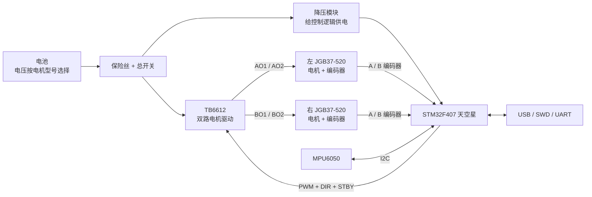

# 二轮平衡车（STM32F407）

## 目标

基于立创·天空星 STM32F407VET6 开发板、一套双通道 TB6612、两套 JGB37-520 减速电机（带编码器）和 MPU6050，完成一台能够直立、循迹或遥控扩展的 FreeRTOS 二轮平衡车。

第一阶段目标不是追求高速，而是完成：

- MPU6050 姿态采集与角度估计；
- 两路电机 PWM、方向和待机控制；
- 两路编码器测速；
- 直立环、速度环和转向环的基础闭环；
- 传感器超时、倾角过大和失控时的安全停机。

## 当前状态

状态：**硬件方案评审 / 有条件适配**

| 子系统              | 结论         | 依据                                                 |
| ---------------- | ---------- | -------------------------------------------------- |
| STM32F407VET6 主控 | 适配         | 168 MHz，Cortex-M4F，定时器、I2C、UART 和 GPIO 资源充足        |
| 开发板 IO           | 适配         | 官方说明为 100 脚封装兼容设计，排针引出全部可用 IO，共 70 PIN             |
| MPU6050          | 适配         | 3.3 V 供电、I2C 接口；官方有对应 STM32F407 例程                 |
| TB6612 控制接口      | 适配         | 双通道，方向 + PWM + STBY；F407 可提供全部控制信号                 |
| TB6612 功率能力      | 有条件适配      | 官方模块页标称输出电流约 1 A/通道，数据手册典型持续能力约 1.2 A/通道；是否足够取决于电机 |
| JGB37-520 编码器    | 适配但需分配定时器  | 两路正交编码器需要 4 个定时器输入，可用 TIM2/TIM3                    |
| 供电               | 不能直接由开发板承担 | 开发板是 3.3 V 逻辑板，没有电机电源、电池管理和电机功率级                   |
| 机械结构             | 尚未确认       | 还需底盘、轮毂、联轴器、电机座和电池固定方案                             |

总体判断：

> **电气控制和软件资源适配，可以作为项目主控；功率级不能直接用开发板供电，TB6612 是否足够必须根据 JGB37-520 的实际型号和负载确认。当前只能按“低负载原型车”设计，不能默认适合大扭矩、高加速或频繁堵转场景。**

## 硬件基线

### 开发板

官方产品页确认所选型号为：

```text
立创·天空星 STM32F407VET6 开发板-青春版
```

关键资源：

| 项目 | 参数 / 说明 |
| --- | --- |
| MCU | STM32F407VET6，Cortex-M4F |
| 最高主频 | 168 MHz |
| Flash | 512 KB |
| SRAM | 192 KB，其中普通 SRAM 128 KB、CCM 64 KB |
| IO | 70 PIN 排针引出 |
| 高速晶振 | 8 MHz |
| 低速晶振 | 32.768 kHz |
| 板载 Flash | W25Q128 |
| 存储 | TF 卡座 |
| USB | Type-C |
| 逻辑电源 | SCJA1117B-3.3 LDO，3.3 V |
| 其他 | USB ESD、自恢复保险丝、复位 / BOOT / 用户按键、红绿 LED |

参考：

- [产品页](https://lckfb.com/project/detail/lckfb-lspi-skystar-stm32f407vet6-lite?param=baseInfo)
- [官方硬件简介](https://wiki.lckfb.com/zh-hans/tkx/hardware/explain.html)
- [STM32F407VxT6 开发板教程](https://wiki.lckfb.com/zh-hans/tkx/tkx-stm32f407vxt6/)

注意：天空星是同一个 100 脚核心板平台，存在 GD32、HC32、STM32F407 等不同主控版本。Wiki 的部分公共硬件说明仍以首批 GD32F407 为例，本文以产品页所选 STM32F407VET6 版本为准。

### 电机与驱动

当前按以下数量估算：

```text
JGB37-520 带编码器减速电机 × 2
TB6612FNG 双路电机驱动 × 1
```

TB6612FNG 的主要接口：

| 信号              | 作用                         |
| --------------- | -------------------------- |
| `VM`            | 电机功率电源                     |
| `VCC`           | 逻辑电源，2.7～5.5 V，本项目建议 3.3 V |
| `GND`           | 逻辑与电机电源共地                  |
| `PWMA` / `PWMB` | A / B 两路速度 PWM             |
| `AIN1` / `AIN2` | A 路方向控制                    |
| `BIN1` / `BIN2` | B 路方向控制                    |
| `STBY`          | 高电平工作，低电平待机                |
| `AO1` / `AO2`   | A 路电机输出                    |
| `BO1` / `BO2`   | B 路电机输出                    |

方向控制：

| `AIN1` | `AIN2` | A 路状态 |
| ---: | ---: | --- |
| 0 | 0 | 停止，惯性滑行 |
| 1 | 0 | 正转 |
| 0 | 1 | 反转 |
| 1 | 1 | 制动 |

`BIN1` / `BIN2` 与 B 路相同。

参考：[官方 TB6612 模块教程](https://wiki.lckfb.com/zh-hans/tkx/tkx-stm32f407vxt6/module/control/tb6612-motor-drive-module.html)

### JGB37-520 关键未知项

`JGB37-520` 是减速电机系列名，不是唯一电气规格。购买时至少要确认：

- 额定电压：6 V、12 V 还是 24 V；
- 减速比；
- 空载转速；
- 空载电流；
- 额定电流；
- 堵转电流；
- 是否带霍尔编码器；
- 编码器每转脉冲数 PPR；
- 编码器供电和输出电平；
- 电机轴形式、轮径和安装孔尺寸。

尤其不能直接使用 24 V 电机配合 TB6612。TB6612 官方模块教程给出 `VM < 12 V`，器件数据手册的工作上限通常为 13.5 V，绝对最大值为 15 V，且没有足够的 24 V 电压裕量。

## 适配判断

### MPU6050

适配。

- MPU6050 提供三轴加速度计和三轴陀螺仪；
- 官方模块通常带 LDO，可接受 3～5 V，但建议本项目统一使用 3.3 V；
- 通信接口为 I2C；
- `AD0=0` 时地址为 `0x68`，`AD0=1` 时为 `0x69`；
- WH0 读取 `0x75` 时正常返回 `0x68`，用于检查器件是否存在；
- 板载 DMP 可以辅助姿态融合，但第一版也可先使用互补滤波或简单 Kalman。

参考：[官方 MPU6050 教程](https://wiki.lckfb.com/zh-hans/tkx/tkx-stm32f407vxt6/module/sensor/mpu6050-six-axis-sensor.html)

注意：

- 如果是裸芯片而不是 GY-521 模块，IO 电压上限约为 3.3 V；
- I2C SDA/SCL 需要上拉，常用 4.7 kΩ 到 3.3 V；
- 电机噪声较大时应缩短 I2C 线、远离电机线，必要时降低到 100 kHz；
- IMU 必须刚性固定在车体中心附近，不能随手粘在外壳软垫上。

### 编码器

适配。STM32F407 有多个带编码器模式的定时器。

每个 JGB37-520 编码器包含：

```text
编码器 VCC
编码器 GND
A 相
B 相
```

再加上电机本身的：

```text
电机 + / 电机 -
```

常见电机一共有 6 根线。

若编码器每转 `PPR` 个脉冲、减速比为 `G`，软件按四倍频计数时：

```text
电机轴每转计数 = PPR × 4
输出轴每转计数 ≈ PPR × G × 4
```

最终以实测正反转计数和整轮旋转 360° 的结果为准。

电气注意：

- 编码器若由 5 V 供电，A/B 输出通常也是 5 V；
- STM32 上多数定时器输入脚是 5 V 容忍脚，但必须按具体引脚核对 `FT` 标识；
- 更稳妥的方式是编码器使用 3.3 V 供电，或在 A/B 上加电平转换/分压；
- 不要直接把 5 V 编码器信号接到非 5 V 容忍引脚。

### TB6612 电流能力

这是本项目最大的硬件风险。

官方模块页给出的参数：

```text
VM < 12 V
VCC = 2.7～5.5 V
输出电流约 1 A/通道
```

TB6612FNG 器件典型值通常是：

```text
连续电流约 1.2 A/通道
峰值电流约 3.2 A，短时
```

但“峰值”不能作为连续堵转能力使用。平衡车在起步、反向制动、轮子卡住或车体跌倒时会出现很大的瞬时电流。

适配原则：

- JGB37 空载或轻载电流远低于 1 A：可先做桌面和低速原型；
- 两轮合计持续电流接近或超过 2 A：TB6612 散热和峰值裕量不足；
- 电机堵转电流达到数安培：应换用 BTS7960、MDD10A 等更大电流驱动，或给每个电机单独配置更高电流驱动；
- 即使更换驱动，也要加保险丝、电源开关和合适的电池放电能力。

## 推荐系统架构



### 电源树

示意：

```text
电池正极
  ├── 保险丝 + 总开关
  │     ├── TB6612 VM
  │     └── 5 V 降压模块
  │            └── 开发板规定电源输入
  │                  └── 板上 3.3 V LDO
  │                        ├── STM32F407
  │                        ├── TB6612 VCC
  │                        ├── MPU6050
  │                        └── 编码器，前提是其允许 3.3 V 供电
  └── 电池负极 ───────────── 所有模块 GND
```

必须遵守：

- 电机电源不得从开发板 3.3 V 或 USB 取电；
- 电机电源、开发板电源和外设必须共地；
- `VM` 与逻辑 3.3 V 不是同一个电源；
- TB6612 `VCC` 接 3.3 V，`VM` 接电机电池；
- 电池必须具备 BMS/保护板，充电器必须与电池化学体系匹配；
- USB 调试时尽量避免电机大电流启动，防止电脑 USB 限流或复位；
- 电机附近增加 `100 μF` 以上电解电容和 `0.1 μF` 陶瓷电容，具体容量按布局调整。

## 候选引脚分配

下面是避开官方 TB6612 与 MPU6050 示例已用脚之后的**候选方案**，接线前仍需对照开发板丝印和最新原理图：

| 功能 | 单片机引脚 | 外设 / 模式 | 说明 |
| --- | --- | --- | --- |
| MPU6050 SCL | `PB8` | I2C1_SCL，AF4 | 使用硬件 I2C；也可退回软件 I2C |
| MPU6050 SDA | `PB9` | I2C1_SDA，AF4 | 需要上拉 |
| 左编码器 A | `PA0` | TIM2_CH1 | 编码器模式 TI1 |
| 左编码器 B | `PA1` | TIM2_CH2 | 编码器模式 TI2 |
| 右编码器 A | `PA6` | TIM3_CH1 | 编码器模式 TI1 |
| 右编码器 B | `PA7` | TIM3_CH2 | 编码器模式 TI2 |
| A 路 PWM | `PB6` | TIM4_CH1 | 建议 20 kHz |
| B 路 PWM | `PB7` | TIM4_CH2 | 与 A 路同一定时器 |
| AIN1 | `PC1` | GPIO 输出 | 与官方 TB6612 示例一致 |
| AIN2 | `PC2` | GPIO 输出 | 与官方 TB6612 示例一致 |
| BIN1 | `PC3` | GPIO 输出 | 待核对丝印 |
| BIN2 | `PC4` | GPIO 输出 | 待核对丝印 |
| STBY | `PC5` | GPIO 输出 | 建议由 MCU 控制，便于故障停机 |
| 调试串口 TX | `PA9` | USART1_TX | 可选 |
| 调试串口 RX | `PA10` | USART1_RX | 可选 |
| SWDIO | `PA13` | SWD | 必须保留 |
| SWCLK | `PA14` | SWD | 必须保留 |

官方模块教程中 TB6612 示例使用：

```text
PWMA = PB5 / TIM3_CH2
AIN1 = PC1
AIN2 = PC2
```

本项目需要双路 PWM 和两路硬件编码器，因此不能机械照搬单路示例，否则会把同一个定时器同时分配给 PWM 和编码器。

候选方案对应的资源分工：

```text
TIM2：左轮正交编码器
TIM3：右轮正交编码器
TIM4：两路电机 PWM
I2C1：MPU6050
USART1：调试串口
GPIO：TB6612 方向与 STBY
```

## 模块接线

### TB6612

| TB6612 | 连接 |
| --- | --- |
| `VM` | 电池正极经过保险丝和开关 |
| `VCC` | 开发板 3.3 V |
| `GND` | 电池负极、开发板 GND、编码器 GND |
| `STBY` | `PC5`，高电平使能 |
| `PWMA` | `PB6`，TIM4_CH1 |
| `AIN1` | `PC1` |
| `AIN2` | `PC2` |
| `PWMB` | `PB7`，TIM4_CH2 |
| `BIN1` | `PC3` |
| `BIN2` | `PC4` |
| `AO1/AO2` | 左电机两根电机线 |
| `BO1/BO2` | 右电机两根电机线 |

注意：TB6612 输出端接的是电机两根粗线，编码器四根细线不能接到电机输出端。

### 编码器

每个电机编码器单独连接：

| 编码器线 | 连接 |
| --- | --- |
| `VCC` | 3.3 V 或器件允许的电压 |
| `GND` | 公共地 |
| `A` | 对应定时器 CH1 |
| `B` | 对应定时器 CH2 |

如果发现前进时某个编码器计数为负，优先在软件中取反，不要为了符号随意交换电源线。

### MPU6050

| MPU6050 | 连接 |
| --- | --- |
| `VCC` | 3.3 V |
| `GND` | 公共地 |
| `SCL` | `PB8` / I2C1_SCL |
| `SDA` | `PB9` / I2C1_SDA |
| `AD0` | 接地时地址 `0x68` |
| `INT` | 第一版可不接，后续可用数据就绪中断 |

## 软件架构草案

### FreeRTOS 任务

| 任务 | 建议周期 | 优先级 | 职责 |
| --- | ---: | --- | --- |
| `vImuTask` | 500 Hz～1 kHz | 高 | 读取 MPU6050，做零偏补偿和姿态估计 |
| `vControlTask` | 200～500 Hz | 高 | 直立环、速度环、转向环、输出限幅 |
| `vMotorTask` | 200 Hz～1 kHz | 中 | 更新 PWM、方向、STBY 和故障保护 |
| `vTelemetryTask` | 20～100 Hz | 低 | 串口或无线发送角度、速度、占空比 |

编码器建议用定时器硬件编码器模式，不建议用 GPIO 双边沿中断做高频四倍频计数。

### 控制环

第一版建议串级 PID：

```text
MPU6050 角度/角速度
  -> 直立环
  -> 目标速度差
  -> 左右轮速度环
  -> PWM 限幅
  -> TB6612
```

编码器提供左右轮速度，同时用于：

- 计算车体前进速度；
- 计算转向角速度；
- 平衡两轮负载；
- 判断堵转和打滑；
- 辅助静止零速保持。

### 安全逻辑

必须实现：

- 上电默认 `STBY=0`，电机不输出；
- MPU6050 连续通信失败超过阈值立即停机；
- 倾角超过安全范围立即停机；
- PWM 变化做斜坡限制，禁止瞬间满占空比反转；
- 设置最大占空比；
- 编码器长时间无变化但 PWM 较高时判定堵转；
- 调试串口或无线失联时进入低速保护；
- 故障后需要显式复位才能重新使能电机。

## 当前适配风险

| 风险                            | 等级  | 处理                       |
| ----------------------------- | --- | ------------------------ |
| JGB37-520 堵转/加速电流超过 TB6612 能力 | 高   | 获取电机完整规格；必要时更换大电流驱动      |
| 电机电压与 TB6612 VM 范围不匹配         | 高   | 24 V 电机禁止直接使用 TB6612     |
| 电机噪声导致 MPU6050 复位、I2C 错误      | 中   | 分离电源、共地、缩短走线、增加去耦        |
| 编码器 5 V 输出接错引脚                | 中   | 查引脚 FT 属性；优先 3.3 V 或电平转换 |
| 电池直接接开发板                      | 高   | 必须使用合适降压和开发板规定输入         |
| 电机反电动势和频繁正反转                  | 中   | 加电容、保险丝、软启动和方向死区         |
| 机械重心过高或轮距不合适                  | 高   | 先做底盘几何和重量分布              |
| IMU 安装松动                      | 高   | 刚性固定，标定轴向和零偏             |

## 下一步

- [ ] 确认 JGB37-520 的具体型号、电压、减速比、电流和编码器 PPR
- [ ] 确认是 2 个带编码器电机，而不是单电机或不带编码器版本
- [ ] 实测单个电机空载电流和堵转电流，并记录供电电压
- [ ] 选择电池电压、容量、BMS 和充电器
- [ ] 估算整车质量、轮径、重心和期望速度
- [ ] 确认 TB6612 是否足够；不足时选择更高电流驱动
- [ ] 核对天空星 STM32F407VET6 最新原理图与候选引脚
- [ ] 搭建 5 V/3.3 V 控制电源和电机电源，先不接 MCU 验证电压
- [ ] 完成 MPU6050 器件 ID 读取和陀螺仪零偏标定
- [ ] 单电机空载验证 PWM、正反转、STBY
- [ ] 验证两路编码器正负方向与整轮计数
- [ ] 建立 FreeRTOS 工程和任务框架
- [ ] 完成速度环和直立环调试
- [ ] 增加倾角、堵转、传感器超时和急停保护

## 关键决策记录

| 日期 | 决策 | 原因 |
| --- | --- | --- |
| 2026-10-23 | 主控继续采用天空星 STM32F407VET6 | 定时器、I2C、IO 和算力足够 |
| 2026-10-23 | 初版候选 IO 为 TIM2/TIM3 编码器、TIM4 双路 PWM、PB8/PB9 I2C | 避免定时器与传感器引脚冲突 |
| 2026-10-23 | 暂不将 TB6612 定为最终功率方案 | JGB37-520 的电流规格未知，持续 1 A/通道裕量可能不足 |
| 2026-10-23 | 电机电源与开发板逻辑电源分离 | 防止电机启动压降和噪声导致 MCU 复位 |

## 日志

### 2026-10-23

- 创建立项笔记。
- 核实开发板为天空星 STM32F407VET6 青春版，168 MHz、70 PIN IO。
- 核实板载 3.3 V LDO、8 MHz 晶振、W25Q128、TF 卡和 Type-C。
- 核实官方已有 STM32F407 的 MPU6050 与 TB6612 例程。
- 结论：控制接口适配，功率与供电需要外部设计；TB6612 对 JGB37-520 属于待确认项。

## 相关笔记

- [[概念-STM32F407-FreeRTOS启动与内存布局]]
- [[仓库-FreeRTOS-Kernel-M4移植层解析]]
- [[仓库-FreeRTOS-Kernel-FreeRTOSConfig配置详解]]
- [[仓库-FreeRTOS-Kernel-核心层API与原理]]
- [[学习-RTOS-学习路线]]
- [[MOC-RTOS]]

## 资料

- [立创·天空星 STM32F407VET6 产品页](https://lckfb.com/project/detail/lckfb-lspi-skystar-stm32f407vet6-lite?param=baseInfo)
- [天空星硬件简介](https://wiki.lckfb.com/zh-hans/tkx/hardware/explain.html)
- [STM32F407VxT6 开发板教程](https://wiki.lckfb.com/zh-hans/tkx/tkx-stm32f407vxt6/)
- [官方 TB6612 模块教程](https://wiki.lckfb.com/zh-hans/tkx/tkx-stm32f407vxt6/module/control/tb6612-motor-drive-module.html)
- [官方 MPU6050 模块教程](https://wiki.lckfb.com/zh-hans/tkx/tkx-stm32f407vxt6/module/sensor/mpu6050-six-axis-sensor.html)
- [天空星引脚分配速查](https://wiki.lckfb.com/zh-hans/web-tool/fdb-pinout.html)
