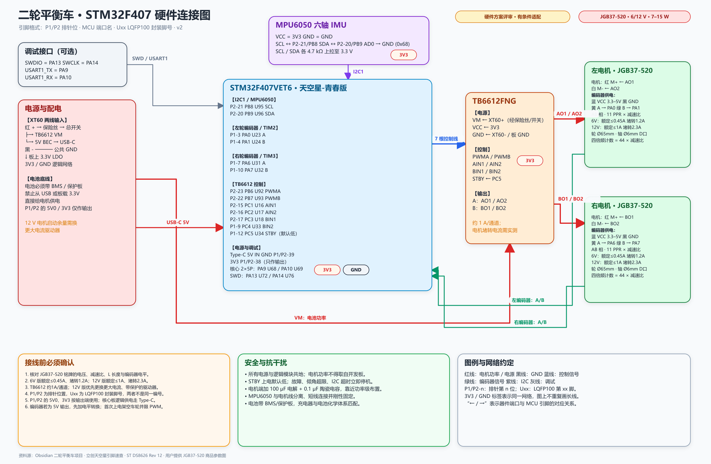

# 二轮平衡车硬件连接图



可编辑源文件：[二轮平衡车-STM32F407-硬件连接.excalidraw](二轮平衡车-STM32F407-硬件连接.excalidraw)

电机详细资料：[JGB37-520 参数汇总](JGB37-520-参数汇总.md)

## 资料依据

- 主项目笔记：`knowledgeRepo/10-Projects/进行中项目/二轮平衡车/二轮平衡车-STM32F407.md`
- 主控：立创·天空星 STM32F407VET6 开发板-青春版
- 姿态传感器：MPU6050，I2C 地址 `0x68`
- 电机驱动：TB6612FNG 双通道模块
- 电机：JGB37-520 带编码器减速电机 × 2

## 候选引脚分配

编号含义：

- `P1-n` / `P2-n`：天空星左右两侧 40P 排针位置，n 为排针序号。
- `Uxx`：STM32F407VET6 LQFP100 封装引脚号，依据 ST 数据手册 `DS8626 Rev 12`。

| 功能 | 排针位置 | STM32 端口 | LQFP100 封装脚 | 外设 / 模式 |
| --- | --- | --- | ---: | --- |
| MPU6050 SCL | `P2-21` | `PB8` | 95 | I2C1_SCL，AF4 |
| MPU6050 SDA | `P2-20` | `PB9` | 96 | I2C1_SDA，AF4 |
| 左编码器 A | `P1-3` | `PA0` | 23 | TIM2_CH1 |
| 左编码器 B | `P1-4` | `PA1` | 24 | TIM2_CH2 |
| 右编码器 A | `P1-7` | `PA6` | 31 | TIM3_CH1 |
| 右编码器 B | `P1-10` | `PA7` | 32 | TIM3_CH2 |
| A 路 PWM | `P2-23` | `PB6` | 92 | TIM4_CH1 |
| B 路 PWM | `P2-22` | `PB7` | 93 | TIM4_CH2 |
| AIN1 | `P2-15` | `PC1` | 16 | GPIO 输出 |
| AIN2 | `P2-16` | `PC2` | 17 | GPIO 输出 |
| BIN1 | `P2-17` | `PC3` | 18 | GPIO 输出 |
| BIN2 | `P1-9` | `PC4` | 33 | GPIO 输出 |
| STBY | `P1-12` | `PC5` | 34 | GPIO 输出，上电默认低 |
| 调试串口 TX | 核心板 2×5P 调试排针 | `PA9` | 68 | USART1_TX |
| 调试串口 RX | 核心板 2×5P 调试排针 | `PA10` | 69 | USART1_RX |
| SWDIO | 核心板 2×5P 调试排针 | `PA13` | 72 | SWDIO |
| SWCLK | 核心板 2×5P 调试排针 | `PA14` | 76 | SWCLK |

> 本表按**青春版核心板没有插在筑基学习底板上**的场景整理。若安装在筑基学习板上，`PB8/PB9`、`PB6/PB7`、`PA0` 等会与底板 LCD、音频、I2C 设备或按键共用，必须重新做资源冲突检查。

## 接线约束

- `VM` 接经过保险丝和总开关的电池功率，介于器件允许范围；笔记给出的模块条件为 `VM < 12 V`。
- `VCC` 接 `3V3`，所有逻辑、传感器、编码器和驱动模块必须共地。
- 开发板逻辑电源由 Type-C 5V 输入；P1/P2 上的 `5V0`、`3V3` 按官方说明按输出端使用，不作为反向电源输入。
- 两轮电机线分别接 `AO1/AO2`、`BO1/BO2`；编码器四根细线不能接电机输出。
- SCL/SDA 分别用 `4.7 kΩ` 上拉到 `3.3 V`；`AD0` 接地时地址为 `0x68`。
- 编码器优先使用 `3.3 V` 供电；若输出为 5 V，先做电平转换或确认目标引脚为 `FT`。
- TB6612 约 `1 A/通道` 只是原型参考，必须按 JGB37-520 的实际堵转电流和持续电流复核散热与余量。
- 本图是候选接线图；量产或长期运行前仍需核对天空星最新原理图、丝印和电源电流预算。

## XT60 两线接法

XT60 只是电池连接器，两个端子分别接电池正负极。TB6612 的电机电源输入是 `VM` 和 `GND`：

```text
XT60 红线（电池 +）
  -> 3 A 保险丝（原型起始值）
  -> 总开关
  -> TB6612 VM

XT60 黑线（电池 -）
  -> TB6612 GND
  -> 同时与开发板 GND、降压模块 GND、编码器 GND 共地
```

不要把 XT60 红线接 TB6612 `VCC`。`VCC` 是 3.3 V 逻辑电源，应接开发板 `3V3`。XT60 也不能直接接开发板 P1/P2 的 `5V0` 或 `3V3` 引脚。

如果同一块电池还要给开发板供电，应从保险丝和总开关之后分出一路到 5 V 降压模块：

```text
XT60 + -> 保险丝 -> 总开关 -> 分电点
                             ├-> TB6612 VM
                             └-> 5V 降压 IN+

XT60 - ---------------------- TB6612 GND / 5V 降压 IN- / 开发板 GND

5V 降压 OUT+ -> Type-C 5V 供电端
5V 降压 OUT- -> 公共 GND
```

建议在 TB6612 的 `VM` 与 `GND` 附近并联 `100–470 μF` 电解电容和 `0.1 μF` 陶瓷电容，电解电容注意正负极。3 A 保险丝只是原型起始值；最终额定值必须结合电机铭牌、线径和实测工作和堵转电流确定。
