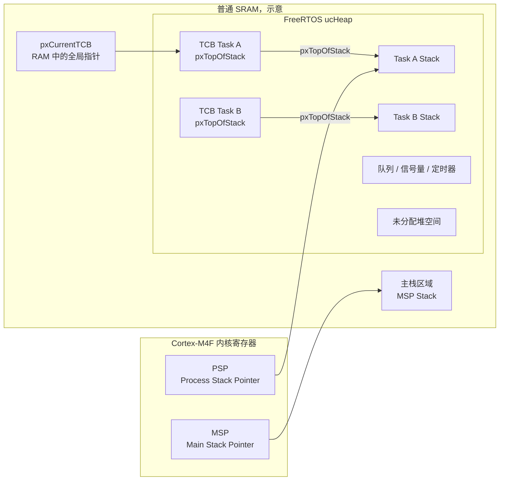
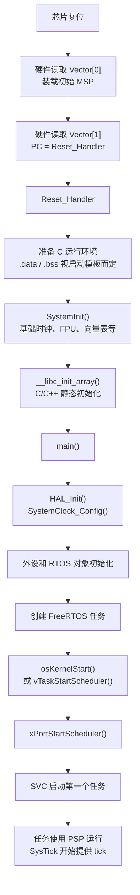
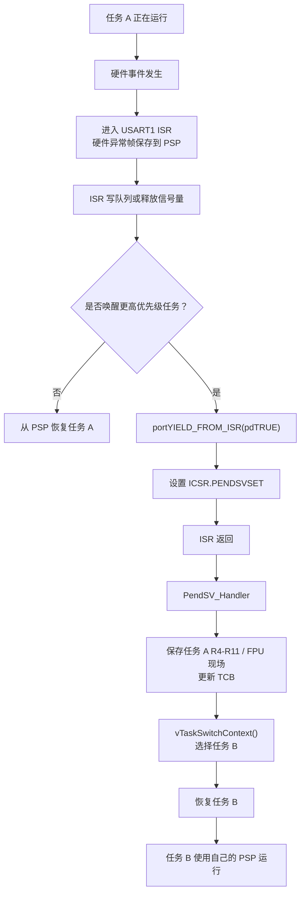

# 概念-STM32F407-FreeRTOS 启动、上下文与内存布局

## 一句话总结

STM32F407 上电后由启动文件建立初始 MSP 和异常向量表，`Reset_Handler` 初始化运行环境并进入 `main()`；FreeRTOS 启动调度器后通过 SVC 运行第一个任务，此后任务使用各自的 PSP 任务栈，异常处理使用 MSP，真正的任务切换由 PendSV 保存和恢复上下文完成。TCB 是 RAM 中的任务管理结构，任务栈是另一块 RAM 区域，`MSP` / `PSP` 则是指向这两类栈区的 CPU 特殊寄存器。

> 本文以 STM32F407、Cortex-M4F、FreeRTOS-Kernel 的 `portable/GCC/ARM_CM4F/` 移植层和 STM32Cube GCC 启动文件为背景。不同 STM32CubeMX / STM32CubeF4 版本生成的 `startup_stm32f407xx.s` 和链接脚本可能略有差异，以工程中的实际文件为准。

## 1. MSP、PSP、TCB 与任务栈的内存分布

### 1.1 先区分“寄存器”和“RAM 对象”

| 对象 | 本质 | 默认位置 | 作用 |
| --- | --- | --- | --- |
| `MSP` | Cortex-M 内核寄存器 | CPU 内核中 | 指向主栈，Handler 模式固定使用 |
| `PSP` | Cortex-M 内核寄存器 | CPU 内核中 | 指向当前任务栈，任务运行时的 SP |
| 主栈 | RAM 栈区 | 普通 SRAM，通常靠近 RAM 顶部 | 启动阶段、异常和 ISR 的函数调用栈 |
| 任务栈 | 每任务独立的 RAM 栈区 | 默认从 FreeRTOS 堆分配 | 保存任务局部变量、调用现场和异常帧 |
| TCB | RAM 中的结构体 | 默认从 FreeRTOS 堆分配 | 保存任务状态、优先级、链表节点和栈顶指针 |
| `ucHeap` | FreeRTOS 管理的连续内存池 | 通常在 `.bss` | 为 TCB、任务栈、队列、信号量等分配内存 |
| `pxCurrentTCB` | 全局指针变量 | RAM 的 `.data` / `.bss` | 指向当前任务 TCB |

`MSP` 和 `PSP` 不是两块 RAM，而是两个寄存器。它们里面保存的是地址，地址分别指向 RAM 中的栈区。

### 1.2 STM32F407 的典型 RAM 范围

STM32F407 常见存储资源如下：

| 区域 | 典型地址 | 大小 | 说明 |
| --- | --- | ---: | --- |
| Flash | `0x08000000` 起 | 512 KB / 1 MB，视型号 | 向量表、代码、常量 |
| CCM RAM | `0x10000000` 起 | 64 KB | CPU 可访问，DMA 不能访问 |
| SRAM1 | `0x20000000` 起 | 112 KB | 普通系统 SRAM |
| SRAM2 | `0x2001C000` 起 | 16 KB | 普通系统 SRAM |
| 普通 SRAM 连续范围 | `0x20000000`～`0x2001FFFF` | 128 KB | SRAM1 + SRAM2 |

实际可用大小和链接地址以芯片型号、链接脚本和 CubeMX 配置为准。

### 1.3 内存布局示意

下面的顺序是典型 GCC 工程的示意，具体排列由 `.ld` 链接脚本决定：



箭头只表示真实引用或寄存器指向关系，不表示内存地址的先后顺序。TCB 与任务栈在 `ucHeap` 中的先后位置取决于运行时分配顺序。

典型连续地址的排列可以表示为：

```text
0x08000000  Flash：向量表、.text、.rodata

0x20000000  .data
            .bss
            ucHeap
              TCB Task A
              Task A Stack
              TCB Task B
              Task B Stack
              队列 / 信号量 / 定时器等
              未分配的 ucHeap
            主栈区域
0x20020000  _estack，128 KB SRAM 顶部
```

这个排列只是示意图，实际顺序由链接脚本和运行时分配器决定。

### 1.4 TCB 与任务栈是两块独立内存

使用动态创建：

```c
xTaskCreate(
    vTaskA,
    "TaskA",
    256,
    NULL,
    5,
    &taskAHandle
);
```

FreeRTOS 至少会分配：

```text
TCB_TaskA：任务管理结构
TaskA_Stack：任务的栈内存
```

TCB 中的关键成员：

```c
typedef struct tskTaskControlBlock
{
    volatile StackType_t * pxTopOfStack;

    ListItem_t xStateListItem;
    ListItem_t xEventListItem;

    UBaseType_t uxPriority;
    StackType_t * pxStack;

    char pcTaskName[ configMAX_TASK_NAME_LEN ];

    /* 其他通知、事件、TLS 和调试字段 */
} tskTCB;
```

`pxTopOfStack` 不是任务运行中的实时 SP。它记录的是：

> 任务下一次被恢复时，PendSV 应该从哪个位置取回上下文。

任务正在运行时，实时栈顶在 `PSP` 中。任务被切换出去时，PendSV 才把当前 PSP 和额外寄存器现场整理好，并更新 `pxTopOfStack`。

### 1.5 动态分配、静态分配与 heap_3

| 创建方式 | TCB 位置 | 任务栈位置 |
| --- | --- | --- |
| 动态创建 + `heap_1/2/4/5` | FreeRTOS `ucHeap` | FreeRTOS `ucHeap` |
| 动态创建 + `heap_3` | C 库 `malloc()` 分配的堆 | C 库 `malloc()` 分配的堆 |
| 静态创建 | 用户提供的 `StaticTask_t` 对象 | 用户提供的 `StackType_t[]` 数组 |

静态创建示例：

```c
static StaticTask_t xTaskABuffer;
static StackType_t xTaskAStack[ 256 ];

taskAHandle = xTaskCreateStatic(
    vTaskA,
    "TaskA",
    256,
    NULL,
    5,
    xTaskAStack,
    &xTaskABuffer
);
```

静态对象的地址通常能从 `.map` 文件直接找到；动态对象的地址由分配器在运行时决定。

### 1.6 任务运行时、ISR 执行时的栈

任务 A 在 Thread 模式使用 PSP 运行。此时 USART1 中断到来：

```text
Thread 模式：
    SP = PSP

硬件异常入口：
    将 R0-R3、R12、LR、PC、xPSR 压入任务 A 的 PSP 栈

Handler 模式：
    SP = MSP
    ISR 的局部变量和函数调用使用主栈
```

因此同一个 ISR 执行期间，可能同时存在：

```text
PSP -> 任务 A 的硬件异常帧
MSP -> USART1_IRQHandler 和 HAL_UART_IRQHandler 的调用栈
```

嵌套 ISR 继续使用 MSP，任务 A 的 PSP 异常帧不会被覆盖。

### 1.7 主栈大小与任务栈大小不是一回事

启动文件中的 `_Min_Stack_Size` 主要约束 MSP 主栈：

```text
启动过程
异常处理
ISR 局部变量
ISR 函数调用
中断嵌套
```

FreeRTOS 任务栈由 `xTaskCreate()` 的栈深度参数决定。`StackType_t` 是 32 位，因此：

```text
任务栈字节数 ≈ 栈深度 × 4 + 对齐和分配器开销
```

任务栈还必须容纳任务自身调用现场和硬件异常帧。增大 startup 的主栈不能解决任务栈溢出。

### 1.8 如何查看实际地址

在调试器中可查看下面的表达式：

```c
pxCurrentTCB
pxCurrentTCB->pxTopOfStack
pxCurrentTCB->pxStack
__get_MSP()
__get_PSP()
```

创建任务时保存了句柄，则可以在调试器中沿句柄检查 TCB 和栈地址：

```c
TaskHandle_t taskAHandle;

taskAHandle;          /* Task A TCB 地址 */
taskAHandle->pxStack; /* Task A 栈地址附近 */
```

应用代码不应依赖 TCB 的内部结构；这些表达式主要用于调试。正式代码应使用 FreeRTOS 提供的任务状态、栈水位等 API。

也可以查看链接生成的 `.map` 文件，搜索：

```text
ucHeap
_estack
.stack
.bss
.data
```

如果使用 CCM，还要检查链接脚本是否明确把某些段放到了 `0x10000000`。CCM 中的任务栈不能作为 DMA 目标缓冲区。

## 2. STM32F407 上电启动流程

### 2.1 启动总流程



### 2.2 复位后的第一件事

Cortex-M 复位时不从 `main()` 开始，而是根据向量表：

```text
Vector[0] -> 初始 MSP
Vector[1] -> Reset_Handler
```

STM32F407 普通程序通常在 Flash 的 `0x08000000` 处放置向量表。启动向量表第一项保存 RAM 顶部地址，例如：

```text
_estack = 0x20020000
```

之后 MSP 从这里向低地址增长。

### 2.3 `Reset_Handler` 做什么

典型职责：

1. 确保 MSP 已设置为启动文件或链接脚本定义的栈顶。
2. 初始化 `.data` 和清零 `.bss`；有些模板由 C runtime 或工具链启动代码完成。
3. 调用 `SystemInit()`，完成芯片基础初始化。
4. 调用 `__libc_init_array()`，运行静态初始化数组。
5. 调用 `main()`。
6. 正常情况下永不返回；若返回则进入死循环。

不同 STM32Cube 启动模板的细节略有差异，但“向量表 → `Reset_Handler` → `SystemInit` → `main`”的主线一致。

### 2.4 `main()` 中与 FreeRTOS 有关的顺序

常见结构：

```c
int main( void )
{
    HAL_Init();
    SystemClock_Config();

    MX_GPIO_Init();
    MX_USART1_UART_Init();
    MX_FREERTOS_Init();

    osKernelStart();

    while( 1 )
    {
    }
}
```

关键点：

- `MX_FREERTOS_Init()` 创建任务和内核对象。
- 创建任务时，任务只是进入就绪状态，还没有开始运行。
- `osKernelStart()` / `vTaskStartScheduler()` 才真正启动调度器。
- `xPortStartScheduler()` 配置 SysTick、PendSV 和 FPU，然后通过 SVC 启动第一个任务。
- 第一个任务开始后，普通任务切换主要由 PendSV 完成。

### 2.5 MSP 和 PSP 的交接

```text
复位后到调度器启动前：
    Thread 模式使用 MSP

SVC 启动第一个任务：
    Handler 模式使用 MSP
    SVC 从第一个任务 TCB 取得任务栈顶
    写入 PSP
    通过 EXC_RETURN 返回任务上下文

第一个任务开始运行：
    Thread 模式使用 PSP

之后每次任务切换：
    保存旧任务 PSP 到旧 TCB
    从新 TCB 取得栈顶并写入 PSP
```

所以“异常使用 MSP”指的是异常处理函数自身的执行栈；被中断任务的异常现场仍保存在被中断任务使用的 PSP 栈中。

### 2.6 向量表重定位

标准 Flash 工程通常把向量表放在 Flash 起始地址。使用 Bootloader 时，应用可能从其他地址启动，例如：

```text
Bootloader：0x08000000
Application：0x08008000
```

应用必须让 `SCB->VTOR` 指向自己的向量表：

```c
SCB->VTOR = 0x08008000UL;
```

如果 `VTOR` 错误，SVC、PendSV、SysTick 和外部 IRQ 都可能从旧的向量表取到错误函数地址，表现为断言、默认处理函数死循环或 HardFault。

## 3. 缩写与术语表

### 3.1 CPU、系统与中断

| 缩写 | 英文 | 中文及本文含义 |
| --- | --- | --- |
| CPU | Central Processing Unit | 中央处理器 |
| MCU | Microcontroller Unit | 微控制器，例如 STM32F407 |
| RTOS | Real-Time Operating System | 实时操作系统 |
| ISR | Interrupt Service Routine | 中断服务程序或中断处理函数 |
| IRQ | Interrupt Request | 中断请求；也常用 IRQn 表示中断编号 |
| NVIC | Nested Vectored Interrupt Controller | 嵌套向量中断控制器 |
| SVC | Supervisor Call | 管理员调用异常；FreeRTOS 用它启动第一个任务 |
| PendSV | Pendable Service Call | 可挂起服务调用；FreeRTOS 用它执行任务切换 |
| SysTick | System Tick | Cortex-M 内核系统节拍定时器 |
| FPU | Floating-Point Unit | 浮点运算单元 |
| VFP | Vector Floating-Point | ARM 浮点扩展及寄存器体系的常用称呼 |
| HAL | Hardware Abstraction Layer | 硬件抽象层 |
| CMSIS | Cortex Microcontroller Software Interface Standard | Cortex-M 软件接口标准 |
| GCC | GNU Compiler Collection | GNU 编译器集合，本文指 `arm-none-eabi-gcc` |
| RCC | Reset and Clock Control | STM32 复位与时钟控制模块 |
| GPIO | General-Purpose Input/Output | 通用输入输出 |
| UART | Universal Asynchronous Receiver/Transmitter | 通用异步收发器 |
| USART | Universal Synchronous/Asynchronous Receiver/Transmitter | 通用同步/异步收发器 |
| SPI | Serial Peripheral Interface | 串行外设接口 |
| DMA | Direct Memory Access | 直接内存访问 |

### 3.2 任务、栈与内存

| 缩写 | 英文 | 中文及本文含义 |
| --- | --- | --- |
| TCB | Task Control Block | 任务控制块 |
| MSP | Main Stack Pointer | 主栈指针，Handler 模式固定使用 |
| PSP | Process Stack Pointer | 进程栈指针，任务运行时使用 |
| SP | Stack Pointer | 栈指针，MSP / PSP 的统称 |
| PC | Program Counter | 程序计数器 |
| LR | Link Register | 链接寄存器，保存函数返回地址或 EXC_RETURN |
| PSR | Program Status Register | 程序状态寄存器 |
| xPSR | Combined Program Status Register | APSR、IPSR、EPSR 的合并视图 |
| IPSR | Interrupt Program Status Register | 记录当前异常号；0 表示 Thread 模式 |
| EXC_RETURN | Exception Return | 写入 LR 的异常返回控制值 |
| RAM | Random Access Memory | 随机访问存储器 |
| SRAM | Static Random Access Memory | 静态随机访问存储器 |
| CCM | Core Coupled Memory | 内核耦合内存；F407 有 64 KB，DMA 不可访问 |
| `.bss` | Block Started by Symbol | 未初始化或零初始化全局/静态变量段 |
| ABI | Application Binary Interface | 应用二进制接口 |
| AAPCS | ARM Architecture Procedure Call Standard | ARM 架构过程调用标准 |

### 3.3 FreeRTOS 移植层寄存器与屏障

| 缩写 / 名称 | 英文 | 作用 |
| --- | --- | --- |
| SCB | System Control Block | Cortex-M 系统控制块 |
| ICSR | Interrupt Control and State Register | 中断控制与状态寄存器 |
| SHPR2 / SHPR3 | System Handler Priority Register 2 / 3 | 设置 SVC、PendSV、SysTick 优先级 |
| AIRCR | Application Interrupt and Reset Control Register | 优先级分组、系统复位控制 |
| VTOR | Vector Table Offset Register | 向量表基地址 |
| CPUID | CPU Identification Register | 处理器型号和修订版本 |
| CPACR | Coprocessor Access Control Register | 控制 CP10 / CP11，即 FPU 访问权限 |
| FPCCR | Floating-Point Context Control Register | 控制 FPU 自动与懒保存 |
| BASEPRI | Base Priority Register | 按优先级阈值屏蔽中断 |
| PRIMASK | Priority Mask Register | 屏蔽可配置中断的全局中断标志 |
| DSB | Data Synchronization Barrier | 等待此前数据访问完成 |
| ISB | Instruction Synchronization Barrier | 刷新流水线，使系统寄存器变化立即生效 |
| CLZ | Count Leading Zeros | 统计 32 位数的前导零数量，用于优先级位图 |

### 3.4 FreeRTOS 常见变量前缀

| 前缀 | 含义 | 示例 |
| --- | --- | --- |
| `x` | FreeRTOS 通用变量或 `BaseType_t` 返回值 | `xTaskCreate`、`xYieldRequired` |
| `ux` | 无符号 `UBaseType_t` | `uxPriority` |
| `ul` | 无符号 `unsigned long` | `ulBitmap` |
| `uc` | 无符号 `unsigned char` | `ucPriorityBits` |
| `p` | 指针 | `pvParameters` |
| `px` | 指向结构体或对象的指针 | `pxCurrentTCB`、`pxTopOfStack` |
| `pv` | `void *` 指针 | `pvPortMalloc` |

## 4. PendSV 的启动与触发情况

### 4.1 PendSV 的职责

`PendSV` 不是外设中断，而是 Cortex-M 的系统异常。FreeRTOS 把它作为“延迟执行的任务切换器”：

```text
请求切换
  -> 设置 ICSR.PENDSVSET
  -> 当前 ISR / 任务到达安全返回点
  -> PendSV_Handler 保存旧任务、选择新任务、恢复新任务
```

标准工程中：

```text
PendSV_Handler
    == xPortPendSVHandler
```

两者通常通过向量表、宏映射或包装函数连接。

### 4.2 什么情况会触发 PendSV

| 场景 | 谁请求切换 | 是否一定由 SysTick 触发 |
| --- | --- | --- |
| `taskYIELD()` 主动让出 CPU | 任务 | 否 |
| 当前任务阻塞，例如 `vTaskDelay()`、等待队列 | 任务级 API | 否；阻塞动作本身即可切换 |
| 任务 API 唤醒更高优先级任务 | 任务级 API | 否 |
| ISR 调用 `FromISR` 并唤醒更高优先级任务 | ISR | 否 |
| SysTick 发现延时任务到期 | SysTick | 是 |
| SysTick 发现同优先级时间片需要轮转 | SysTick | 是 |
| 任务优先级变化导致更高优先级任务就绪 | 任务级 API | 否 |
| 系统已有 PendSV 挂起，ISR 返回 | NVIC 尾链 | 否，执行之前已挂起的请求 |

重要结论：

- 不是每个 ISR 结束都要执行 PendSV。
- `portYIELD_FROM_ISR(pdFALSE)` 不会设置 PendSV。
- `portYIELD_FROM_ISR(pdTRUE)` 才请求任务切换。
- 如果 ISR 只读取硬件状态、清除标志，没有改变调度状态，可以直接返回原任务。

### 4.3 典型触发链



### 4.4 为什么 PendSV 推迟执行也不会丢现场

中断到来时，硬件已经自动把基础异常帧压入 PSP 栈：

```text
R0-R3、R12、LR、PC、xPSR
```

普通 C ISR 会遵循 AAPCS，在需要时保存和恢复自己使用的 `R4-R11`。PendSV 暂时未运行时，任务现场仍然受到保护：

- 当前任务异常帧在 PSP 任务栈中。
- TCB 和 `pxCurrentTCB` 仍在 RAM 中。
- 任务还没有被正式切换到其他任务。
- `pxTopOfStack` 暂时保持旧值，但任务正在运行时并不依赖它恢复实时现场。

PendSV 最终运行后，才会：

1. 读取当前 PSP。
2. 保存 `R4-R11`，FPU 活跃时保存 `s16-s31`。
3. 将新栈顶写回当前 TCB。
4. 调用 `vTaskSwitchContext()`。
5. 从新 TCB 恢复新任务。

### 4.5 如果 PendSV 正在执行时来了 ISR

PendSV 使用 MSP。更高优先级 ISR 可以抢占 PendSV：

```text
任务 A
  -> PendSV 开始保存任务 A
  -> ISR 抢占 PendSV，使用 MSP
  -> ISR 返回
  -> PendSV 从被抢占的位置继续
  -> 切换到任务 B
```

PendSV 在更新内核调度结构时会提高 `BASEPRI`，屏蔽允许调用 FreeRTOS API 的中断，避免 ISR 在 `pxCurrentTCB`、就绪链表等状态正在变化时访问内核。数值更小、优先级更高的紧急 ISR 仍可抢占，但不能调用 FreeRTOS API。

### 4.6 第一个任务不是 PendSV 启动的

启动调度器时：

```text
vTaskStartScheduler()
  -> xPortStartScheduler()
  -> prvPortStartFirstTask()
  -> SVC 0
  -> vPortSVCHandler()
  -> 从第一个任务 TCB 恢复 PSP 和上下文
```

因此：

```text
第一个任务：SVC 启动
后续任务切换：PendSV 完成
SysTick：tick 事件和切换请求的来源之一
```

### 4.7 PendSV 的处理器与业务 ISR 的分工

| 项目 | 业务 ISR，例如 USART | PendSV |
| --- | --- | --- |
| 触发来源 | 外设硬件事件 | 软件设置挂起位 |
| 主要职责 | 读取硬件、清标志、通知任务 | 保存/恢复任务上下文 |
| 是否保存完整 TCB 现场 | 否 | 是 |
| 优先级 | 通常高于 PendSV | 最低 |
| 用户是否应写业务代码 | 是 | 否 |

## 5. `startup_stm32f407xx.s` 基本汇编语法

### 5.1 startup 文件的两类内容

阅读时先区分：

| 类型 | 示例 | 是否由 CPU 执行 |
| --- | --- | --- |
| 汇编器指令 | `.section`、`.word`、`.weak`、`.equ` | 否，指导汇编器和链接器 |
| CPU 指令 | `ldr`、`mov`、`bl`、`b`、`bx` | 是 |

以 `.` 开头的大多是汇编器指示符，不是运行时指令。

### 5.2 文件头部的目标声明

典型内容：

```asm
.syntax unified
.cpu cortex-m4
.fpu fpv4-sp-d16
.thumb

.global g_pfnVectors
.global Default_Handler
```

| 语法 | 作用 |
| --- | --- |
| `.syntax unified` | 使用统一的 ARM / Thumb 汇编语法 |
| `.cpu cortex-m4` | 指定目标内核为 Cortex-M4 |
| `.fpu fpv4-sp-d16` | 指定 FPv4-SP 单精度浮点扩展 |
| `.thumb` | 后续使用 Thumb / Thumb-2 指令 |
| `.global` | 导出符号，供链接器和其他文件使用 |

如果工程使用无 FPU 或软件浮点，实际 startup 可能使用不同的 `.fpu` 设置。F407 的 CM4F FreeRTOS port 要求编译器、启动文件和工程配置保持一致。

### 5.3 `.equ`：定义汇编常量

```asm
.equ _Min_Stack_Size, 0x400
.equ _Min_Heap_Size,  0x200
```

`.equ` 类似汇编中的常量定义：

```text
_Min_Stack_Size = 1024 字节
```

它们主要供链接脚本、启动栈和 C 库堆配置使用。

### 5.4 `_estack` 和 `ldr r0, =_estack`

链接脚本通常定义：

```asm
_estack = ORIGIN(RAM) + LENGTH(RAM);
```

启动文件使用：

```asm
ldr r0, =_estack
mov sp, r0
```

`ldr r0, =_estack` 是 GNU 汇编的伪指令写法：

> 把 `_estack` 这个链接符号最终解析出的地址装入 `r0`。

它不是从 `_estack` 地址取内容，而是取得 `_estack` 的地址值。

### 5.5 `.section`：定义段

```asm
.section .isr_vector, "a", %progbits
```

含义：

| 部分 | 含义 |
| --- | --- |
| `.isr_vector` | 段名 |
| `"a"` | allocatable，运行时分配地址 |
| `%progbits` | 段中包含实际数据，不只是占位空间 |

常见段：

| 段 | 内容 |
| --- | --- |
| `.isr_vector` | 异常向量表 |
| `.text` | 代码 |
| `.rodata` | 常量 |
| `.data` | 有非零初值的全局/静态变量 |
| `.bss` | 零初始化或未初始化数据 |
| `.stack` | 主栈 |

### 5.6 `.word`：写入 32 位数据

```asm
g_pfnVectors:
    .word _estack
    .word Reset_Handler
    .word NMI_Handler
    .word HardFault_Handler
```

每个 `.word` 占 4 字节。

这里不是“调用函数”，而是把地址写进向量表：

```text
Vector[0] = _estack 的地址值
Vector[1] = Reset_Handler 的函数地址
Vector[2] = NMI_Handler 的函数地址
```

端口初始化后，任务或异常发生时，CPU 才根据异常号从表中取出地址并跳转。

### 5.7 标签与冒号

```asm
Reset_Handler:
Default_Handler:
Infinite_Loop:
```

以 `标签:` 开头的行定义一个符号。它可以表示函数入口，也可以表示数据位置。

在 C 中看似函数名：

```c
Reset_Handler
```

它在汇编中首先是一个符号或地址标签。

### 5.8 `Reset_Handler` 示例

```asm
.section .text.Reset_Handler
.weak Reset_Handler
.type Reset_Handler, %function

Reset_Handler:
    ldr r0, =_estack
    mov sp, r0

    bl SystemInit
    bl __libc_init_array
    bl main

LoopForever:
    b LoopForever

.size Reset_Handler, . - Reset_Handler
```

| 指令或语法 | 含义 |
| --- | --- |
| `.weak Reset_Handler` | 定义弱符号，可被强定义覆盖 |
| `.type ..., %function` | 告诉工具链这是函数 |
| `ldr r0, =_estack` | 将 RAM 栈顶地址装入 `r0` |
| `mov sp, r0` | 设置栈指针 |
| `bl SystemInit` | 跳转调用，保存返回地址到 LR |
| `bl main` | 调用 C 的 `main()` |
| `b LoopForever` | 无条件跳转 |
| `.size ..., . - ...` | 当前地址减去起始地址，得到符号大小 |

`b` 与 `bl` 的区别：

```asm
b  目标       ; 普通跳转，不保存返回地址
bl 目标       ; 带链接跳转，类似函数调用
bx lr         ; 跳回 LR 保存的返回地址
```

### 5.9 无限循环的写法

```asm
LoopForever:
    b LoopForever
```

也可以写成：

```asm
    b .
```

`.` 表示当前汇编位置，因此 `b .` 就是“跳回当前指令”，形成死循环。

### 5.10 `.weak` 与 `.thumb_set`

启动文件常为未实现中断提供：

```asm
.weak USART1_IRQHandler
.thumb_set USART1_IRQHandler, Default_Handler
```

含义：

```text
如果没有用户提供的强定义 USART1_IRQHandler，
就让这个符号指向 Default_Handler。
```

如果 `stm32f4xx_it.c` 中定义了：

```c
void USART1_IRQHandler( void )
{
    HAL_UART_IRQHandler( &huart1 );
}
```

链接器会使用用户的强定义地址。

### 5.11 `.align`：地址对齐

```asm
.align 3
```

在 GNU ARM 汇编中，`.align n` 通常表示按 `2^n` 字节对齐，因此：

```text
.align 3 -> 2^3 = 8 字节对齐
```

栈和向量表必须满足架构与 AAPCS 的对齐要求。不同汇编器对 `.align` 参数含义可能不同，阅读时要结合工具链文档。

### 5.12 立即数、注释与预处理

```asm
mov r0, #0
```

`#` 通常表示立即数。

常见注释：

```asm
@ 这是 GNU ARM 汇编注释
/* 这也是 startup 中常见的注释 */
```

startup 文件还可能使用 C 预处理器：

```asm
#if defined( STM32F407xx )
    .word USART1_IRQHandler
#endif
```

这些条件会影响最终生成的向量表。

### 5.13 `.type` 和 `.size` 的意义

```asm
.type Default_Handler, %function
.size Default_Handler, . - Default_Handler
```

- `.type` 主要帮助链接器和调试器识别符号类型。
- `.size` 标记函数占用的字节范围。
- 它们不会在运行时执行。

### 5.14 阅读 startup 文件的推荐顺序

1. 看 `.cpu` / `.fpu` / `.thumb`，确认目标架构。
2. 找 `_Min_Stack_Size`、`_Min_Heap_Size`、`_estack`。
3. 找 `.isr_vector` 和 `g_pfnVectors`，确认异常表顺序。
4. 找 `Reset_Handler`，理解启动顺序。
5. 找 `Default_Handler`，理解未实现异常会停在哪里。
6. 搜索具体外设名，例如 `USART1_IRQHandler`、`EXTI0_IRQHandler`。
7. 检查 `.weak` / `.thumb_set`，确认函数是否可以由用户强定义覆盖。
8. 对 FreeRTOS 额外检查 `SVC_Handler`、`PendSV_Handler`、`SysTick_Handler`。

### 5.15 一份快速速查表

| 写法 | 一句话解释 |
| --- | --- |
| `.section` | 切换或定义段 |
| `.word` | 放置 4 字节数据或地址 |
| `.global` | 导出符号 |
| `.weak` | 定义可被覆盖的弱符号 |
| `.thumb_set` | 给符号设置 Thumb 地址别名 |
| `.equ` | 定义常量 |
| `.align` | 地址对齐 |
| `.type` | 标记函数或对象类型 |
| `.size` | 标记符号大小 |
| `label:` | 定义符号地址 |
| `ldr` | 装载寄存器 |
| `mov` | 寄存器赋值 |
| `mrs` / `msr` | 读取/写入特殊寄存器 |
| `b` | 跳转 |
| `bl` | 带返回地址的跳转 |
| `bx` | 按寄存器地址跳转，常用于异常返回 |
| `#imm` | 立即数 |
| `.` | 当前汇编地址 |

## 6. 关键结论速查

1. `MSP`、`PSP` 是 CPU 寄存器，不是 RAM 区域。
2. 主栈通常位于普通 SRAM，初始 MSP 由向量表第 0 项提供。
3. 每个 FreeRTOS 任务有自己的任务栈，任务运行时由 PSP 指向当前任务栈。
4. TCB 和任务栈是两块独立内存；TCB 的 `pxTopOfStack` 只保存恢复任务的栈顶地址。
5. 任务被中断时，硬件基础异常帧压入 PSP 任务栈；ISR 自身使用 MSP。
6. 上电启动主线是“向量表 → `Reset_Handler` → `SystemInit` → `main()`”。
7. FreeRTOS 调度器启动后，第一个任务由 SVC 启动，后续切换主要由 PendSV 完成。
8. SysTick 只是一类切换触发源；任务 API 和 ISR 也能请求 PendSV。
9. 不是所有 ISR 结束都要执行 PendSV；只有需要切换或已有 PendSV 挂起时才执行。
10. startup 文件中的 `.word` 定义向量表地址；真正执行的是 `Reset_Handler` 和默认处理函数等代码。

## 关联

- 移植层源码：[[仓库-FreeRTOS-Kernel-M4移植层解析]]
- 内核核心机制：[[仓库-FreeRTOS-Kernel-核心层API与原理]]
- Cortex-M 架构背景：[[概念-ARM内核架构与FreeRTOS移植]]
- RTOS 配置：[[仓库-FreeRTOS-Kernel-FreeRTOSConfig配置详解]]
- 主题入口：[[MOC-RTOS]]
- 学习路径：[[学习-RTOS-学习路线]]

## 参考源码

- FreeRTOS-Kernel：`/home/congqiang/work/repo/FreeRTOS-Kernel`
- Cortex-M4F 移植：`portable/GCC/ARM_CM4F/portmacro.h`、`portable/GCC/ARM_CM4F/port.c`
- STM32CubeF4 启动文件：`startup_stm32f407xx.s`
- STM32CubeF4 链接脚本：工程中的 `.ld` 文件
- STM32F407 设备头文件：`stm32f407xx.h`
